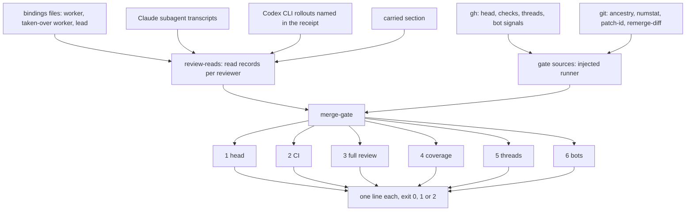
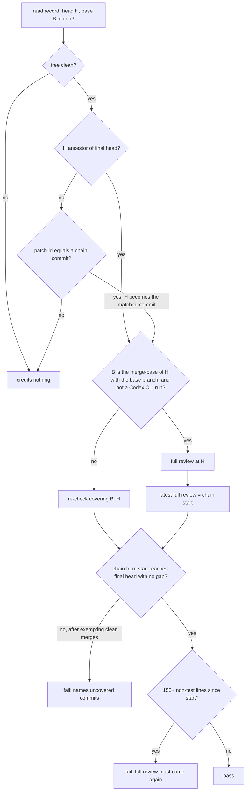

# A merge gate that checks the review covered the final head - Plan

## Goal Capsule

- **Objective:** a lead that merges without asking the maintainer can show, from a check it runs and not from the worker's prose, that the head it merges was reviewed and that every later fix was re-checked.
- **Means:** a `merge-gate` script beside the receipt check reads the live pull request, git and the review subagents' transcripts, and exits 0 only when the merge bar holds on one pinned head (KTD1, KTD2). Story-worker and project-lead gain the steps that feed it and run it (U5, U6).
- **Authority:**
  1. KOD-44's description: the six conditions, the side changes and the rollout.
  2. This plan.
  3. The proposal it builds on, `research/2026-11-07-merge-gate-proposal.md` in the maintainer's planning repo, where this plan does not override it.
- **Stop conditions:** stop and ask the lead if:
  - a unit needs a runtime dependency (grove ships none, `docs/decisions/dependency-adoption.md`);
  - an existing test's assertion has to be weakened or deleted to go green, rather than updated to new pinned text;
  - a read record (KTD3) cannot be found in a real review subagent's transcript from a current harness;
  - `main` has moved the files a unit names so that its approach no longer applies.
- **Execution profile:** test-first in every unit. U1 to U4 are script code with fixture transcripts and a stubbed `gh`. U5 and U6 are skill text, pinned by sentence tests plus a by-eye portability read.
- **Who finishes:** each unit is one story for one worker, carried to its own pull request. The lead accepts each hand-back. Merges follow the repo's rules.

---

## Product Contract

### Summary

A new script, `merge-gate`, runs right before a lead merges. It takes the pull request and the head the lead means to merge. It checks six conditions on that head: the head itself, CI, a full review that read it, re-checks covering every commit since that review, resolved threads, and the bot reviews. It prints one line per condition and exits 0, 1 or 2. The receipt check starts listing every review a worker ran and what each one read. Story-worker binds the full review skill on every pull request and a doc review for docs-only changes, and makes the reviewer record what it read. Project-lead runs the gate before every merge: first for a shadow week that records its verdict, then as a blocking precondition.

### Problem Frame

Leads now merge without asking the maintainer, under a standing approval that holds only while reviews and fix cycles run first. The receipt check is what a lead has to go on, and it cannot tell either of those things.

It proves a review skill was called at least once (`skills/supervision-setup/scripts/receipt-check.mjs`, header "Its limits"). The first matching call wins (`operation-state.mjs`, `judge`), so one early review credits the operation for the rest of the story. It drops each call's arguments (`transcript-uses.mjs`, `claudeUses`) and never runs git or gh, so it cannot say which head a review read. On 11-07 a receipt credited a review that read `52a2540`, while the shipped head was `6560df2`, 135 non-test lines later. The worker said so in prose, and the check passed.

Two worker-side gaps feed this. The floor `review` binds the native single-pass reviewer, and the full review skill runs only "when the change's scope calls for it" (`skills/story-worker/routing.toml`, rows `review` and `review-escalation`). No row binds a doc review at all. And a worker may hand back with a failing receipt check: step 8 only requires the pull-request body's two lines to read `found`.

### Actors

- A1. **Worker** (story-worker session): builds, starts the reviewers, writes the receipt, hands back.
- A2. **Reviewer**: a fresh, non-fork subagent the worker or lead starts, which invokes a review performer. A Codex CLI run is a reviewer too.
- A3. **Lead** (project-lead, or a solo worker acting as its own lead): accepts the hand-back, runs the gate, merges.
- A4. **Automated reviewers**: the repo's bots, such as the Codex connector and Gemini Code Assist.
- A5. **Maintainer**: sets the merge bar in the repo's instructions, and flips the gate from shadow to blocking.

### Requirements

**The gate**

- R1. The gate checks one pinned head: the head the lead passes must equal the pull request's live head and, when a receipt is given, the receipt's shipped revision.
- R2. Every CI check on that head has completed with a passing conclusion, and at least one check reported.
- R3. A full review read that head, or an earlier head that later re-checks connect to it (R4). It ran in a fresh, non-fork reviewer, over a clean tree, from the merge-base of its own reviewed head with the base branch. Its performer is the one bound to `review` in a worker's bindings or to `review-before-merge` in the lead's, or the one bound to `doc-review` when the final pull request is docs-only (KTD6).
- R4. Every commit after the last full review is covered by a re-check whose range starts at or before the end of the previous one. A clean merge from the base branch needs none (KTD5). When the commits since the last full review change 150 or more non-test lines, a full review must come again.
- R5. No review thread on the pull request is unresolved.
- R6. Each automated reviewer the lead names has finished on that head. One that finished only on an earlier head fails, naming that head. A bot account that left a pull-request review without being named fails as unnamed. Comments alone, as CI or dependency bots leave, do not count. One the lead marks unavailable prints `unavailable` with its reason and does not fail.
- R7. Exit 0 means every condition holds, and the last line is `ok <sha>`. Exit 1 means at least one condition fails, with one line per failure. Exit 2 means the gate could not check.
- R8. Where a reviewer's transcript cannot be read, as on another machine, the gate takes the worker's carried output and labels it `carried`. Carried evidence alone never passes R3.

**What feeds the gate**

- R9. The receipt check lists every use of a fresh-context operation, with its arguments and what it read, and stops crediting only the first.
- R10. Story-worker binds the full review skill on every pull request, and a doc review for docs-only changes.
- R11. Every reviewer a worker or lead starts records what it read as commands whose output the harness writes to its transcript: the head, whether the tree was clean, and the base it tells the review performer to diff from.
- R12. A worker hands back ready only on a receipt check that exits 0, or on one failing line the receipt names as an exception for the lead to accept.

**Running it**

- R13. Project-lead runs the gate before every merge, and merges pinned to the head its `ok` line names.
- R14. The gate first runs one shadow week, recording its verdict without blocking. At the week's end the maintainer decides the switch from that week's log, and the gate blocks only once the repo's instructions say so.
- R15. Skill text stays portable: no repo paths, tracker names, versions or harness-specific invocations (grove `AGENTS.md`, "The skills are portable").
- R16. Each unit's pull request bumps both plugin manifests together, and updates `README.md` where its change is part of grove's reference.

### Acceptance Examples

- AE1. **Covers R3, R4.** Given a full review that read `52a2540`, a shipped head `6560df2`, 135 non-test lines between them and no re-check, when the lead runs the gate, then it exits 1 with a coverage line naming each uncovered commit.
- AE2. **Covers R4.** Given a full review at head A, a fix commit B and a fresh re-check whose range is A..B, when B is the pull request's head, then coverage passes.
- AE3. **Covers R4.** Given the same as AE2 but with 160 non-test lines in B, then coverage fails, saying a full review must come again.
- AE4. **Covers R1, R7.** Given a push after the lead ran the gate, when the lead's `--head` no longer equals the live head, then the gate exits 1 on the head line, and `gh pr merge --match-head-commit` would refuse too.
- AE5. **Covers R7.** Given `gh` is not authenticated, the gate exits 2 and names the failing call. It never reports a condition as passed.
- AE6. **Covers R8.** Given a worker on another machine and a lead whose own fresh `review-before-merge` read the final head, carried worker evidence prints `carried` and the gate can pass. Without the lead's review it fails R3.

### Scope Boundaries

- Findings stay a judgment. The gate cannot tell whether a finding was fixed or rejected on evidence, or whether a fix went beyond the findings. It prints a `not checked:` line saying so.
- The merge bar itself and its approval rule stay in each repo's instructions. The gate is a precondition, never an approval.
- No change to how bindings are made, or to what counts as fresh or a fork: the gate reuses the receipt check's rules.

### Deferred to Follow-Up Work

- A repo setting for test paths and docs paths, in place of the built-in patterns (KTD5, KTD6).
- Gating a story whose change spans several repos in one run.
- GRO-58's matcher bug for bare skill copies under a custom config folder, and GRO-67 and GRO-68: separate items.
- hq's `AGENTS.md` change that makes the gate's exit 0 the bar: the maintainer's edit, after the shadow week (U6 hands it the data).

---

## Planning Contract

### Key Technical Decisions

- KTD1. **One new script beside the receipt check, built on its readers.** `skills/supervision-setup/scripts/merge-gate.mjs` imports the transcript readers and the receipt check's exported `checkReceipts`, and adds no dependency. It is the first receipt-family script to start processes, so every `git` and `gh` call goes through one module with an injected runner, the pattern `lease.mjs` uses for its adapter (U3). Tests pass a stub runner for `gh`, and a temporary git repository for `git`, which needs no network.
- KTD2. **The command line pins the head, and the output is one line per condition.** The gate takes `--pr <owner/repo#n>`, `--head <sha>`, one or more `--bindings` (the worker's, any taken-over worker's, and the lead's own), and optionally `--receipt`, `--carried`, `--codex-rollout`, `--bot <name>`, `--bot-unavailable <name>:<reason>` and `--checkout <dir>`. Each condition prints `pass`, `fail`, `carried` or `unavailable` with its reason, then a `not checked:` line, then `ok <sha>` on exit 0. Shadow or blocking is not a flag: it lives in the repo's instructions, so a lead cannot switch it per run.
- KTD3. **A review's head comes from command output in the reviewer's own transcript, not from command lines.** The full review skill diffs the working tree against a base held in a shell variable, so no command line names the head. Its run artifact under a scratch folder does record `head_sha`, but it does not last, and it is another plugin's format. So the reviewer request (U5, U6) has the reviewer run one fixed read command before it invokes the review performer. The command prints three labelled lines: `head <sha>`, `status <count of porcelain lines>`, and `base <sha>`, where the base is the merge-base of the head with the commit the reviewer will diff from. That commit is the base branch for a full review, and the last reviewed head for a re-check. The reviewer then tells the performer to diff from that base, by its commit id. The harness writes the output as a tool result. The gate's **read record** for a reviewer is the last such output before the review call: head, clean or dirty, base. The record credits only when the review call's arguments name the recorded base commit, for a performer that takes a base. A dirty tree credits nothing, and so does a read command in any other form, such as one chained with other commands. Rejected: parsing `git diff A B` lines, which no current review run produces.
- KTD4. **Coverage runs over the first-parent chain from the last full review to the head.** A full review is a read record whose base equals the merge-base of its own head with the base branch. That merge-base never moves for a fixed head, so a later merge from the base branch leaves the review full. A clean merge from the base branch (KTD5) is covered without a re-check. The last full review is the latest one whose head is an ancestor of the final head, or patch-equivalent to one (KTD7). The re-checks form a chain: each read record's base must be the previous link's head or an ancestor of it, and its head an ancestor of the final head. The chain must reach the final head. Overlaps are fine. A gap fails, naming the uncovered commits. A re-check is any fresh, non-fork reviewer that ran a performer bound to `review`, `review-before-merge` or `doc-review`, or a Codex CLI rollout with its own read record (KTD8). A `doc-review` re-check covers only a range whose paths are docs-only by KTD6.
- KTD5. **The 150-line count uses the full review skill's own test pattern.** Lines are added plus deleted from `git log --first-parent --no-merges --numstat` over the commits since the last full review, skipping binary files and any path the test pattern matches. The pattern is copied from the full review skill's scope script, with a comment naming its source, so the gate and the reviewer agree on what a test is. A clean merge from the base branch counts zero lines. A merge whose `--remerge-diff` is non-empty counts those lines and needs a re-check of its own. Rejected: a diff from the review's head to the final head, which counts the base branch's lines after a merge.
- KTD6. **Docs-only is decided by path, never by the `Docs:` line.** The `Docs:` line records doc upkeep, not the kind of change. A pull request is docs-only when every changed path is a markdown file, and none is an agent surface: skills, `SKILL.md`, the instruction files and the plugin manifests, as the full review skill's agent-surface pattern lists them. A manifest change that touches only its `version` field is ignored, since every grove pull request carries one. A mixed pull request needs the full review. The classification is made on the final pull request, so a docs-only review stops counting once a later commit adds a code path. The doc review takes documents, not a range, so its credit needs review calls whose arguments together name every markdown file changed in the range from its read record's base, each after a read record at the reviewed head. That base makes it a full review or a re-check by KTD4.
- KTD7. **A rebase after the review is credited by patch-id, or not at all.** Story-worker forbids rebasing a pushed branch, but the first review runs before the first push, so a rebase onto the base branch before pushing is normal. When a reviewed head is not an ancestor of the final head, the gate compares `git patch-id --stable` of its cumulative merge-base-to-head diff with the cumulative merge-base-to-commit diff of each commit on the final head's chain. A match credits it, for a branch of any length, and the chain then starts at the matched commit. Without this, a rebase before the first push would leave no full review to start the chain, and so force a whole new full review rather than a re-check. A reviewed commit missing from the lead's clone cannot be compared, so it fails, saying so. The worker's remedy is a re-check of the final head. Rejected: `git range-diff`, whose output is a judgment aid, not a yes or no.
- KTD8. **Codex counts in two places, read from two sources.** A connector review is a bot review (R6), found through the pull request's reviews, comments and reactions, using story-worker's step 7 completion signals. A signal counts for a head only when it names that head's SHA, as a review's commit id or a summary row does. A reaction names no SHA, so it counts only when dated after the head's push time, read as the creation time of the earliest check suite on the head. A Codex CLI run is a re-check (R4), never the full review R3 requires, when its rollout is fresh, with no `forked_from_id`, and holds its own read record. No transcript links a `codex exec` started from a shell to its rollout, so the worker names the rollout's path in the receipt, and the lead passes it with `--codex-rollout`.
- KTD9. **Exit 2 is for transport failures only.** These are a `gh` or `git` call that fails, an unauthenticated `gh`, an unreadable listed transcript with no carried section, and bad arguments. Readable evidence that fails, including finding no review at all, is exit 1. Otherwise deleting evidence would turn a 1 into a 2. In blocking mode, 2 means do not merge, the same as 1.
- KTD10. **The receipt check lists every review use, and the handoff parser accepts several.** For operations the table marks `fresh_context`, the receipt check prints one `used` line per creditable call, with the call's arguments and its read record, in time order. Other operations keep one line. The `--handoff` parser accepts several `used` lines for one operation, so a restart carries every review. `judge` keeps first-match credit for the used-or-not verdict, so exit codes stay the same.
- KTD11. **Carried evidence needs a readable review by the lead.** Transcripts are files a worker can write, so carried output can be forged, and so can local ones. The gate always checks the live conditions itself: head, CI, threads and bots. Carried review evidence prints `carried`, and R3 passes on it only when the lead's own fresh `review-before-merge` read the final head in a transcript the lead's bindings list.
- KTD12. **Story-worker's review rows change in place.** `review` lists the full review skill first, ahead of the native reviewer, so setup binds it wherever it is installed. `review-escalation` is removed, since the full review skill sizes its own depth. A new `doc-review` row binds the doc review skill, with `fresh_context = true`. Each change alters the table's sha256, so live sessions re-run setup at their next restart, which the version bump forces anyway.

### High-Level Technical Design

How the gate's inputs reach its conditions:

How condition 4 decides, for each read record:

### Assumptions

- The worker's review subagent runs in the story's checkout, so its git reads see the head it reviews. Story-worker already gives every subagent the checkout's full path. The lead's reviewer runs in a checkout at the pull request's head: the story's worktree where one exists, or else a fresh worktree of the fetched head (U6).
- Worker and lead share one repository's object store, as worktrees of one clone do. Where they do not, KTD7 fails closed, and the remedy is a re-check of the final head.
- Grove's own project-lead says to merge only on the maintainer's approval, "given in your conversation, or by a signal the repo's instructions recognise". A repo whose instructions grant a standing approval meets that clause, so the gate adds a precondition without changing the approval rule.
- The lead passes `--bot` for each automated reviewer the repo's instructions name. The gate takes the list of bots that must finish only from the lead, and fails a bot that reviewed without being named (R6).
- A read record shows the checkout just before the review call, not what the performer diffed. Tying the record to the call's base argument (KTD3) narrows this, and a reviewer that then reviews another checkout is the residual risk the shadow week should watch for.

### Sequencing

U1, U3 and U5 have no dependency on each other, though U2 and U5 both edit the receipt-check test, so whichever merges second rebases onto the first. U2 needs U1, U4 needs U1 and U3, and U6 needs U4 and U5. The shadow week starts when U6 merges.

---

## Implementation Units

### U1. Read records from reviewer transcripts

- **Goal:** a module that gives, for every reviewer subagent and Codex rollout a bindings file reaches, its read records and the review performer calls it made.
- **Requirements:** R3, R4, R8, R11
- **Dependencies:** none
- **Files:**
  - `skills/supervision-setup/scripts/review-reads.mjs` (new)
  - `skills/supervision-setup/scripts/transcript-uses.mjs` (export the record, result and subagent-location helpers it already has)
  - `skills/supervision-setup/scripts/codex-uses.mjs` (export the command-output helper)
  - `test/supervision-review-reads.test.ts` (new), with fixtures under `test/fixtures/supervision/review-reads/`
- **Approach:**
  1. Reuse `transcript-uses.mjs`'s subagent location, its fork and fresh rules and its `tool_use` to `tool_result` pairing. Keep each Bash call's command and result text, and each Skill call's name and arguments.
  2. Recognise only the fixed read command (KTD3), and take its values only from the labelled lines of its result text.
  3. Emit a read record per review performer call: the last triple before it in the same reviewer, with the reviewer's place, freshness, model where recorded, and time.
  4. Read a Codex rollout's command executions the same way, from a path given by the caller.
- **Patterns to follow:** `transcript-uses.mjs` (`records`, `claudeResults`, `resultText`, `usesIn`), `codex-uses.mjs` (`commandOutput`), and the inline JSONL builders in `test/supervision-receipt-check.test.ts`.
- **Test scenarios:**
  - A fresh subagent runs the read command, then the review skill with that base in its arguments: one record with head, clean and base.
  - Two read outputs before one review call: the record takes the later one.
  - The same reads chained with other commands in one call, unlabelled: no record.
  - A review call whose arguments name a base other than the recorded one: the record is marked as not matching.
  - A non-empty status: the record says dirty.
  - A fork subagent with a valid triple: the record is marked not fresh.
  - A subagent with no sidecar: not fresh, as today.
  - The review call comes before any triple: a record with no head.
  - A command line that names a SHA whose result is an error: no head taken.
  - A Codex rollout with the read command and no `forked_from_id`: one fresh record.
  - A rollout with `forked_from_id`: not fresh.
  - A transcript that is listed but missing: an error the caller turns into exit 2.
- **Verification:** the module returns the records the fixtures encode, and the existing receipt-check tests stay green.

### U2. The receipt check lists every review and what it read

- **Goal:** the receipt check prints every use of a fresh-context operation with its arguments and read record, and a handoff carries them all.
- **Requirements:** R9, R8
- **Dependencies:** U1
- **Files:**
  - `skills/supervision-setup/scripts/receipt-check.mjs`
  - `skills/supervision-setup/scripts/handoff-receipt.mjs`
  - `test/supervision-receipt-check.test.ts`
  - `test/supervision-receipt-credit.test.ts`
  - `README.md` (where it describes the check's output)
- **Approach:** per KTD10. The verdict and the exit code still come from `judge`. Only the report lines for fresh-context operations multiply, and each carries `read <head> from <base>` or `read: none recorded`.
- **Patterns to follow:** `formatReport` in `receipt-check.mjs`, and `USED_LINE` in `handoff-receipt.mjs`.
- **Test scenarios:**
  - Two review calls in two fresh subagents: two `used` lines, in time order, each with its read.
  - A review with no recorded read: its line says so, and the operation still reads `used`.
  - A non-fresh-context operation called twice: still one line.
  - A handoff whose section holds two `used` lines for `review`: both carried, each labelled carried.
  - Exit codes for the existing fixtures are unchanged.
- **Verification:** the existing suite passes with only report-text assertions updated, and the new lines appear for the fixtures above.

### U3. Gate sources: git and gh behind one runner

- **Goal:** one module that answers the gate's questions about the pull request and the history, through an injected process runner.
- **Requirements:** R1, R2, R4, R5, R6, R7
- **Dependencies:** none
- **Files:**
  - `skills/supervision-setup/scripts/gate-sources.mjs` (new)
  - `test/merge-gate-sources.test.ts` (new)
- **Approach:**
  1. The default runner is a synchronous spawn with a timeout. Tests pass a stub.
  2. From `gh`: the live head, every status check on it, the creation time of the head's earliest check suite (KTD8), review threads with pagination, and the bots' reviews, comments and reactions with pagination.
  3. From `git`: ancestry, the merge-base, the first-parent commit list, per-commit numstat, `--remerge-diff` for merges, and `patch-id --stable`.
  4. Each answer is a value or a typed transport failure, which the gate maps to exit 2 (KTD9).
- **Patterns to follow:** `lease.mjs`'s injected adapter and timeout, and `test/resume-lease.test.ts`'s stub.
- **Test scenarios:**
  - The stub returns two pages of threads: both pages are read.
  - The stub returns a check still in progress with an empty conclusion: reported as not completed.
  - `gh` exits non-zero: a transport failure carrying the call's name.
  - `gh` returns JSON missing a field: a transport failure, not a pass.
  - A temporary git repo with a merge from the base branch: the merge's lines are excluded, and a conflict-resolved merge reports its remerge lines.
  - A temporary repo with a rebased copy of a commit: the patch-ids match.
  - A binary file and a path under `test/`: excluded from the line count.
- **Verification:** the module's answers match the stub and temporary-repo fixtures. No test reaches the network.

### U4. The merge gate

- **Goal:** the `merge-gate` command, checking R1 to R8 and printing their lines.
- **Requirements:** R1, R2, R3, R4, R5, R6, R7, R8
- **Dependencies:** U1, U3
- **Files:**
  - `skills/supervision-setup/scripts/merge-gate.mjs` (new)
  - `test/merge-gate.test.ts` (new), with fixtures under `test/fixtures/supervision/merge-gate/`
  - `README.md` (a reference section for the gate: arguments, lines, exit codes)
- **Approach:**
  1. Parse arguments per KTD2, the way `receipt-check.mjs` does, and run `main` only under the same realpath guard, so tests can import it.
  2. Gather read records from every bindings file (U1) and the live answers (U3), then evaluate the conditions in order. Every condition runs even after one fails, so the lead sees every failure at once.
  3. Bindings decide which performers count: the native ids bound to `review` and `doc-review` in a worker's bindings, and to `review-before-merge` in the lead's (R3), never one bound by fallback (KTD12).
  4. Apply KTD4 to KTD7 for conditions 3 and 4, KTD8 for Codex, KTD11 for carried evidence.
- **Execution note:** start from AE1 as a failing end-to-end test, built from fixture transcripts and a stub runner.
- **Patterns to follow:** `receipt-check.mjs` for argument parsing, the report format and the exported entry point.
- **Test scenarios:**
  - Covers AE1. Review at an older head, 135 non-test lines since, no re-check: exit 1, and the coverage line names the commits.
  - Covers AE2. Full review at A, fix B, re-check A..B: exit 0, last line `ok <B>`.
  - Covers AE3. As AE2 with 160 non-test lines: exit 1, full review required.
  - Covers AE4. `--head` differs from the live head: exit 1 on the head line.
  - Covers AE5. Stubbed unauthenticated `gh`: exit 2, naming the call.
  - Covers AE6. Unreadable worker transcript plus carried section, with and without the lead's readable final-head review: exit 0 with `carried`, then exit 1.
  - The only review ran in a fork: fails R3.
  - The review read a dirty tree: fails R3.
  - Re-checks A..B and C..D with a gap B..C: fails, naming B..C.
  - Overlapping re-checks: pass.
  - A re-check that told the review performer to diff from A while its read command recorded the pull request's merge-base: credits nothing.
  - Full review at A, then a clean merge from the base branch as the head: passes, with zero lines counted.
  - A docs-only pull request whose doc review names every changed markdown file: passes R3. The same with two files and one named: fails R3.
  - A docs-only review, then a later commit that adds a `skills/` path: fails, needing the full review.
  - The lead's `review-before-merge` read the final head and no worker review did: passes R3.
  - A lead review whose read record's head is not an ancestor of the pull request's head: does not count.
  - A manifest change of only `version` in a docs pull request: still docs-only.
  - Rebased before push, patch-id equal: credited. Reviewed commit absent from the clone: fails, saying so.
  - One unresolved thread: fails R5.
  - A named bot with no signal on the head: fails as not finished. The same bot passed as unavailable with a reason: an `unavailable` line, no failure.
  - A named bot whose last review names an earlier head: fails, naming that head.
  - A bot that left a review on the pull request but was not named: fails as unnamed. A CI bot's comment alone: no failure.
  - A Codex connector 👍 dated after the head's earliest check suite: the bot passes. One dated before it: the bot has not finished.
  - A Codex CLI rollout from the merge-base to the head, with no other review: fails R3, since a CLI run is only a re-check.
  - `review` bound by fallback: fails R3, saying the review ran by fallback.
  - No checks reported on the head: fails R2.
- **Verification:** every acceptance example passes as a test, `npm run typecheck` is clean, and running the command with `--help` prints its arguments.

### U5. Story-worker binds the full review and makes reviewers record what they read

- **Goal:** every story's reviews produce the read records the gate needs, through the right performers, and a worker hands back only on a passing receipt check.
- **Requirements:** R6, R10, R11, R12, R15
- **Dependencies:** none
- **Files:**
  - `skills/story-worker/routing.toml`
  - `skills/story-worker/SKILL.md` (steps 5, 7 and 8)
  - `skills/story-worker/references/receipt.md` (`Reviewed by`, and an exception field)
  - `AGENTS.md` (the review loop: the full review skill runs on every pull request)
  - `test/supervision-routing-tables.test.ts`, `test/session-restart-skill.test.ts` and any test pinning step 5, 7 or 8 sentences
  - `test/supervision-receipt-check.test.ts`, `test/fixtures/supervision/bindings.example.json` and `test/fixtures/supervision/receipt-check/handoff-with-receipt.md`, which read or quote the live story table: their `review-escalation` cases are retargeted to `review` or `doc-review`, not deleted
  - `skills/supervision-setup/scripts/routing-table.mjs` (a comment naming `review-escalation`)
  - `README.md` (what the routing tables expect of a repo)
- **Approach:**
  1. Change the rows per KTD12.
  2. Step 5's first paragraph invokes the performer bound to `review` on every change, and drops the sentence that invokes `review-escalation`.
  3. Step 5's "Check what it read" gains one instruction to the reviewer: run the fixed read command before invoking the review performer, and tell the performer to diff from the base it printed (KTD3). The existing quote-and-compare check stays.
  4. Step 5 runs the `doc-review` performer, in place of `review`, only for a change that is docs-only by KTD6, naming every changed markdown file.
  5. Step 7 asks each automated reviewer that re-reviews only on request to review the final head before the hand-back (R6).
  6. A Codex CLI review's rollout path goes in the receipt's `Reviewed by` entry.
  7. Step 8 requires receipt-check exit 0 for `STATUS: ready`, or one named exception in the receipt for the lead to accept or send back (R12).
  8. `AGENTS.md`'s review loop says the full review skill runs on every pull request, replacing the native reviewer as the floor.
- **Execution note:** write the failing pinned-sentence tests first, then the text, then run the portability patterns over every changed section.
- **Patterns to follow:** the step 8 sentences `test/supervision-routing-tables.test.ts` already pins, and the row shape every `[[operation]]` follows.
- **Test scenarios:**
  - The `review` row's first performer is the full review skill, `review-escalation` is gone, and `doc-review` exists with `fresh_context = true` and a fallback.
  - Step 5 holds the read-command instruction, pinned whole, and no longer names `review-escalation`.
  - Step 7 holds the final-head re-review request, pinned whole.
  - Step 8 holds the exit-0 rule and the exception rule, pinned whole, and still matches no `gh`, `github` or `curl`.
  - Every changed section passes the portability patterns.
  - Setup's binding tests still bind every row of the changed table.
- **Verification:** `npm test` is green, and a by-eye read finds no repo path, version or tracker word in the new text.

### U6. Project-lead runs the gate, first in shadow

- **Goal:** the lead runs the gate before every merge, records its verdict for one week, and blocks on it once the repo's instructions say so.
- **Requirements:** R13, R14, R15, R16
- **Dependencies:** U4, U5
- **Files:**
  - `skills/project-lead/SKILL.md` (step 7, between checking what blocks the merge and asking for it)
  - `skills/project-lead/routing.toml` (the `review-before-merge` intent: its reviewer records what it read, per R11)
  - `docs/decisions/supervision-operating-model.md` (a new decision for the gate and its shadow week)
  - `test/supervision-routing-tables.test.ts` and any test pinning lead step 7
  - `README.md`
- **Approach:**
  1. Step 7 item 3 starts the lead's reviewer in a checkout at the pull request's head (the Assumptions say which), runs the fixed read command there, and has it diff from the base it printed (KTD3). The `review-before-merge` row's intent and fallback carry the same instruction.
  2. Step 7 runs the gate script from the supervision-setup folder with the pull request, the head it read, every bindings file of the story and its own, the receipt, any carried section, every Codex rollout the receipt names, and the bots the repo's instructions name.
  3. Until the repo's instructions make the gate blocking, the lead puts the gate's lines in the merge note and in the story's work note, and logs a disagreement with its own check as a gate bug or a review gap.
  4. Once blocking, the lead merges only on exit 0, pinned to the `ok` line's head. A 1 or a 2 goes back to the worker, or to the maintainer.
  5. The decision records the switch: after one shadow week, the maintainer reads the week's log and makes the gate blocking in the repo's instructions, unless an open gate bug or an unexplained exit 2 remains (R14).
- **Patterns to follow:** project-lead step 7's numbered items, and how D26 and D27 in `docs/decisions/supervision-operating-model.md` record a rule with its reason.
- **Test scenarios:**
  - Step 7 holds the gate item, pinned whole, in order between items 5 and 6.
  - Project-lead's whole text still passes the portability patterns. The 150-line threshold appears only in script code and the README, not in skill text.
  - The `review-before-merge` row still binds the full review skill with `fresh_context = true`, and its intent holds the read-command instruction, pinned whole.
  - Step 7's gate item names the receipt, the carried section and the Codex rollouts among its inputs.
- **Verification:** `npm test` is green. Once the unit merges, a lead's next merge note carries the gate's lines.

---

## Verification Contract

| Gate | Command | Applies to |
| --- | --- | --- |
| Types | `npm run typecheck` | every unit |
| Tests | `npm test` | every unit |
| Secrets | gitleaks, in CI only | every unit |
| Install shape | the test that imports every `skills/supervision-setup/scripts/*.mjs` from a copy with no `node_modules` | U1 to U4 |
| Portability | `test/supervision-routing-tables.test.ts`, plus a by-eye read of changed skill text | U5, U6 |
| Manifests | `test/plugin-manifests.test.ts`: both versions equal and bumped | every unit |
| Review | the full review skill in a fresh subagent, whose last review read the final head, plus the repo's bots | every unit |

---

## Definition of Done

- Every unit's pull request is green on the checks above, bumps both manifests, and carries its `Capture:` and `Docs:` lines.
- AE1 to AE6 pass as tests in `test/merge-gate.test.ts`.
- `README.md` documents the gate's arguments, lines and exit codes, and the receipt check's new lines.
- No test reaches the network, and no script needs a runtime dependency.
- Code from an abandoned approach is removed, not left in the diff.
- After U6 merges, leads run the gate in shadow, and the decision records when blocking may start.

---

## Appendix

### Sources

- KOD-44's description: the gaps, the six conditions, the side changes and the rollout.
- The proposal, `research/2026-11-07-merge-gate-proposal.md`, in the maintainer's planning repo.
- The merge bar: the "Merges are delegated" rule in the maintainer's planning repo's `AGENTS.md`, with its interim rule.
- `skills/supervision-setup/scripts/receipt-check.mjs`: the "Its limits" header, `checkReceipts` exported, the realpath guard.
- `skills/supervision-setup/scripts/operation-state.mjs`, `judge`: first match wins.
- `skills/supervision-setup/scripts/transcript-uses.mjs`: `claudeUses` drops the Skill call's `args`; `claudeResults` and `resultText` pair calls with results; the fresh and fork rules.
- `skills/supervision-setup/scripts/lease.mjs`: the only script that spawns processes today, through an injected adapter.
- `skills/story-worker/routing.toml`, rows `review` and `review-escalation`; `skills/project-lead/routing.toml`, row `review-before-merge`.
- The full review skill's scope reference: it diffs the working tree against `$BASE`, or reads `gh pr diff` for a remote pull request. Its run artifacts: `metadata.json` holds `head_sha` under a scratch folder. Its scope script: the test and agent-surface patterns, and a 200-line floor for its own full depth, which is separate from the merge bar's 150.
